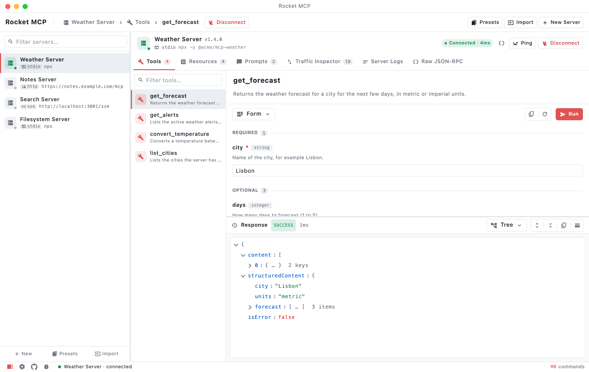
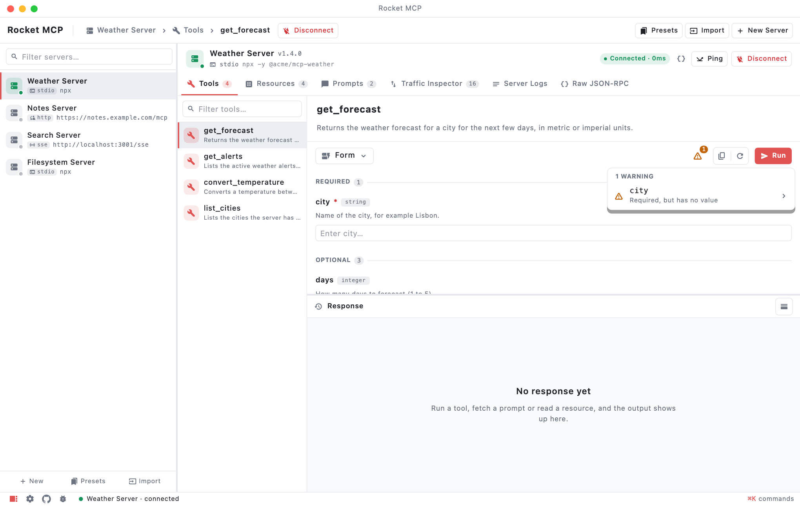
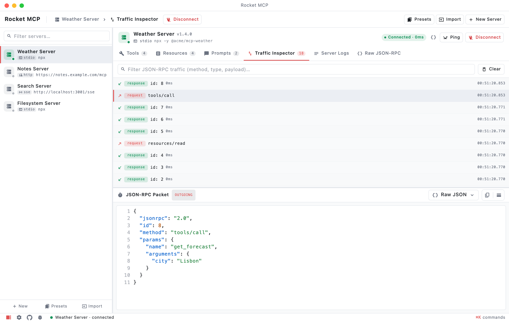
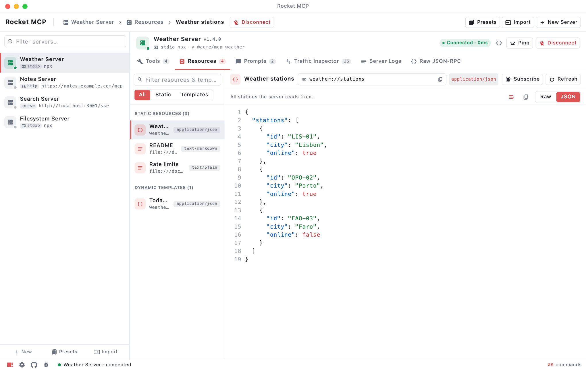
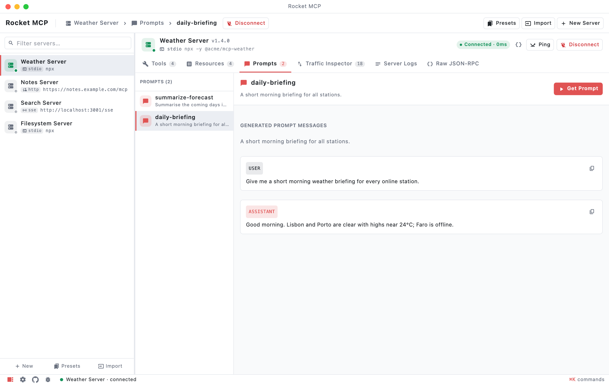
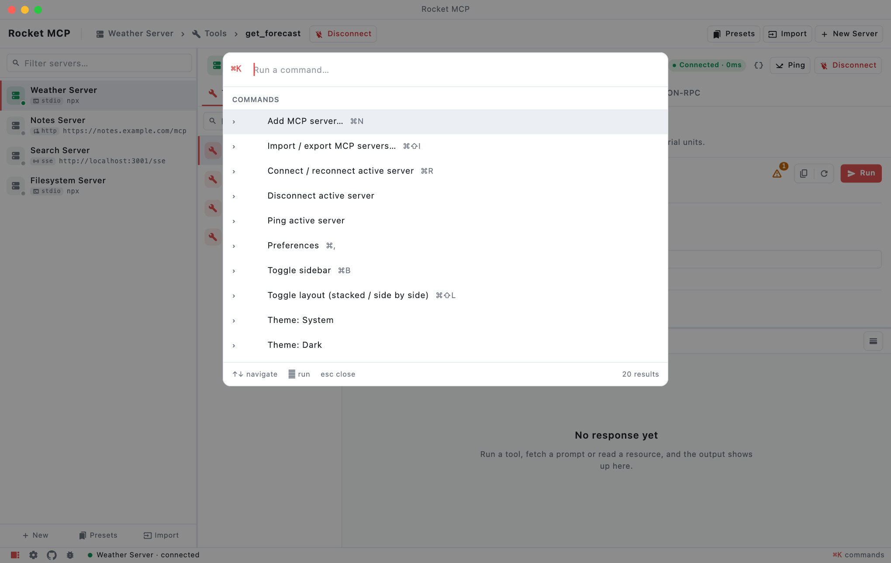
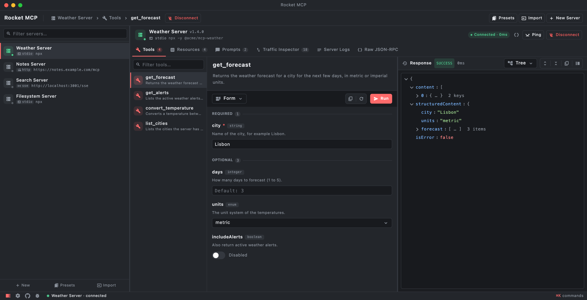

<h1 align="center">Rocket MCP</h1>

<p align="center">
  A desktop client for testing <a href="https://modelcontextprotocol.io">Model Context Protocol</a> servers.<br>
  Connect, call tools, read resources, fetch prompts and watch every message. Runs on macOS, Windows and Linux.
</p>

<p align="center">
  
</p>

## Why Rocket MCP

- **Every transport.** Local **stdio** processes, **SSE** and **streamable HTTP** endpoints, side by side in one list, each with its own command, environment, URL and headers.
- **Everything loads on connect.** The moment a server answers, its tools, resources, resource templates and prompts are fetched together, so you can start testing straight away.
- **Real forms for tools.** Each tool's input schema becomes a form: text, numbers, switches, drop-downs and JSON editors, with required arguments first and a warnings list that takes you to the field that needs attention. Prefer raw JSON? Switch to the editor, with live validation.
- **See what is on the wire.** A traffic inspector records every JSON-RPC message with timing, server logs show what a process prints, and a raw JSON-RPC console sends anything you type.
- **Fast and keyboard friendly.** A command palette, shortcuts for the common actions, light and dark themes, and panels that remember their size.
- **Your data stays yours.** Servers and settings are plain JSON in `~/.rocketmcp`. Nothing is sent anywhere except your connections to MCP servers.

## Features at a glance

| | |
|---|---|
| **Servers** | stdio, SSE and streamable HTTP; arguments, working directory, environment variables, headers; connect on startup; quick templates for common servers; duplicate, filter, import and export |
| **Tools** | A form from the input schema (string, number, integer, boolean, enum, array, object), a JSON body editor with validation, warnings with drilldown, ⌘↵ to run, copy and clear |
| **Results** | Formatted text, raw JSON with line numbers, an expandable tree, image content; call duration |
| **Resources** | Read on select, URI templates with a live resolved URI, MIME-type icons, subscriptions to changes |
| **Prompts** | Arguments, fetched on select when none are required, messages shown by role |
| **Traffic Inspector** | Every request, response and notification in both directions, filter, raw and tree packet views, round-trip time |
| **Server Logs** | A server's standard error and log messages, filter |
| **Raw JSON-RPC** | Send any method with any parameters |
| **Import / export** | Claude Desktop `claude_desktop_config.json` in and out |
| **Desktop polish** | Native menus on macOS, a custom title bar, resizable and remembered panels, update notices, a one-click **Report an issue** |

See the [user manual](docs/user-manual.md) for how to use each of these, and [docs/features.md](docs/features.md) for the tour with screenshots.

## Screenshots

| | |
|---|---|
|  |  |
| **Warnings** that jump to the field | **Traffic Inspector** with a packet open |
|  |  |
| **Resources** and templates | **Prompts** |
|  |  |
| **Command palette** (⌘K / Ctrl+K) | **Dark theme**, side-by-side layout |

<sub>The screenshots show a fictional demo "Weather Server".</sub>

## Run it

There are no installers yet. You need [Flutter](https://docs.flutter.dev/get-started/install) (stable) with the desktop toolchain for your system:

```sh
git clone https://github.com/prateekthakur272/rocket_mcp.git
cd rocket_mcp
flutter pub get
flutter run -d macos      # or -d windows, -d linux
```

Many MCP servers start with `npx` or `uvx`, so install Node.js and/or [uv](https://docs.astral.sh/uv/) to use the sample servers. On first launch a short tour introduces the app. See [getting started](docs/getting-started.md).

## Your first tool call

1. **⌘N / Ctrl+N**, pick a template such as *Everything Server*, **Add Server**.
2. Select it and press **Connect**. Its tools, resources and prompts load.
3. On **Tools**, choose a tool, fill in the arguments and press **Run** (**⌘↵ / Ctrl+Enter**).

## Documentation

The pages are in [`docs/`](docs). The screenshots in them are generated from the real UI (see [building and releasing](docs/building-and-releasing.md#regenerating-the-screenshots)).

**Using Rocket MCP**

| Page | What it covers |
|---|---|
| [Getting started](docs/getting-started.md) | Install, first run, and your first tool call |
| [Features](docs/features.md) | A tour of everything the app does, with screenshots |
| [User manual](docs/user-manual.md) | The whole interface, screen by screen |
| [Servers and transports](docs/servers-and-transports.md) | stdio, SSE and streamable HTTP; environment variables, headers, presets |
| [Testing tools](docs/testing-tools.md) | Argument forms, the JSON editor, validation, warnings and results |
| [Resources and prompts](docs/resources-and-prompts.md) | Reading resources, URI templates, subscriptions, fetching prompts |
| [Traffic and logs](docs/traffic-and-logs.md) | The traffic inspector, server logs and raw JSON-RPC |
| [Import and export](docs/import-export.md) | Claude Desktop configuration |
| [Keyboard shortcuts](docs/keyboard-shortcuts.md) | Every shortcut |
| [Data and storage](docs/data-and-storage.md) | What is saved on disk and where |
| [Troubleshooting](docs/troubleshooting.md) | Common problems and fixes |

**Building and contributing**

| Page | What it covers |
|---|---|
| [Contributing](docs/contributing.md) | Setup, conventions, tests and sending a change |
| [Project structure](docs/project-structure.md) | The folders and files of `lib/` |
| [Architecture](docs/ARCHITECTURE.md) | Layers, state, the connection lifecycle and the rules |
| [Engineering guidelines](docs/guidelines.md) | The standards every change follows |
| [Building and releasing](docs/building-and-releasing.md) | Running, testing, building and regenerating the screenshots |

## Contributing

Bug reports, ideas and pull requests are welcome. Start with [docs/contributing.md](docs/contributing.md). In short: `flutter analyze` and `flutter test` must pass, and `core/` must stay free of UI imports.

## License

No license has been chosen yet.
