# Features

A tour of what Rocket MCP does. Each section links to the page that explains it in full.

## Connect to any MCP server

Three transports are supported: **stdio** (a local process the app starts), **SSE** and **streamable HTTP** (remote endpoints). Each server keeps its command, arguments, environment variables, working directory, URL and headers. Servers can connect automatically when the app starts. Quick templates fill in well-known servers. See [servers and transports](servers-and-transports.md).

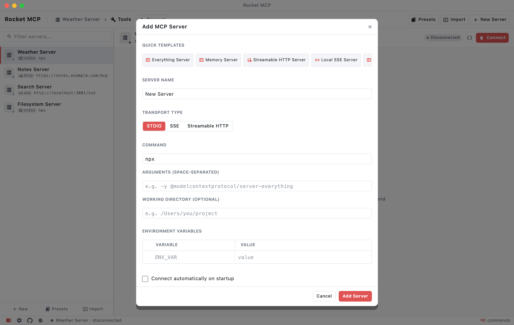

## Everything loads on connect

The moment a connection is up, Rocket MCP asks the server for its tools, resources, resource templates and prompts together, and measures the round-trip time with a ping. It only asks for what the server says it supports. The lists also update on their own when a server announces that they changed.

## Test tools

Pick a tool and Rocket MCP builds a form from its input schema: text fields, numbers, switches for booleans, drop-downs for enums and JSON editors for arrays and objects. Required arguments come first. Switch to the **JSON** editor to type the body yourself, with live validation. A warnings button lists everything that blocks a run and takes you to the field. See [testing tools](testing-tools.md).

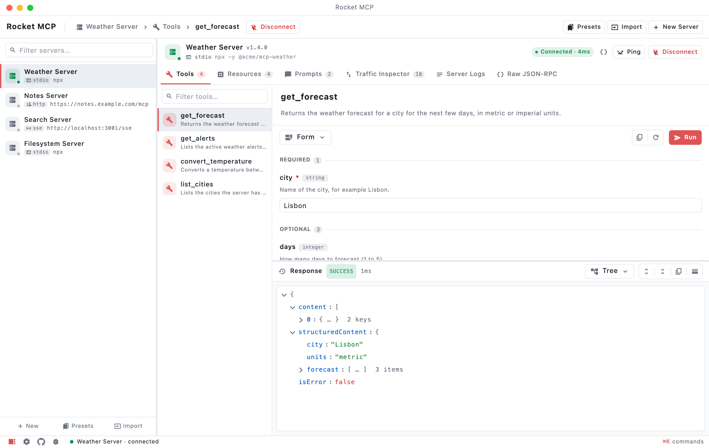

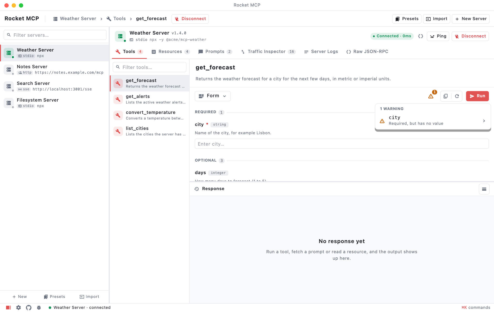

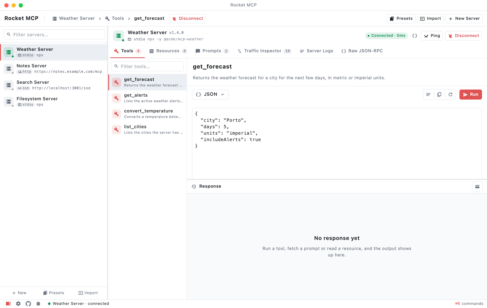

## Read resources, fill in templates, fetch prompts

Selecting a resource reads it immediately. Resource templates become input fields, and the resolved URI updates as you type. You can subscribe to a resource for change notifications. A prompt without required arguments is fetched as soon as you select it; others wait for their arguments. See [resources and prompts](resources-and-prompts.md).

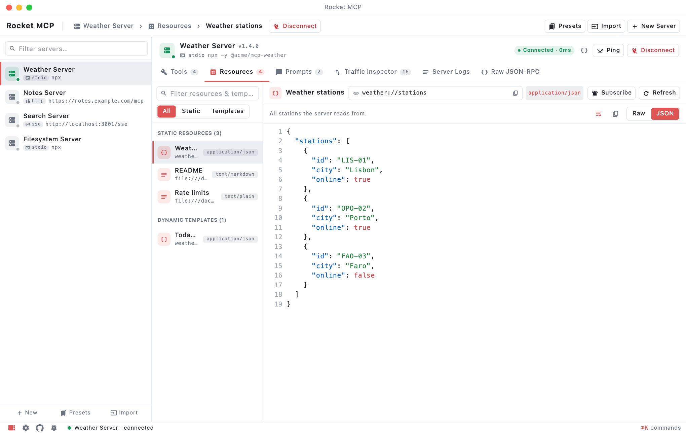

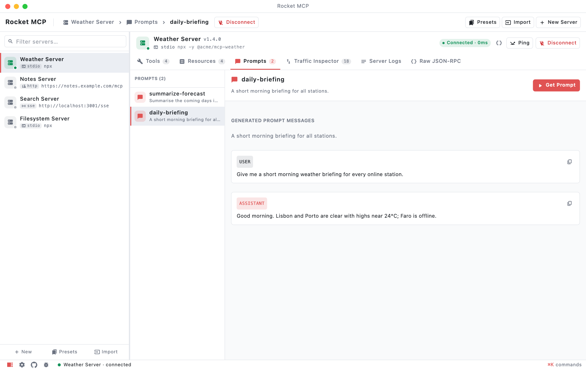

## See every message

The **Traffic Inspector** records every JSON-RPC request, response and notification with direction, method and timing. Filter it, click a row to see the packet as raw JSON or an expandable tree. **Server Logs** shows what the server prints, and **Raw JSON-RPC** sends any method you type. See [traffic and logs](traffic-and-logs.md).

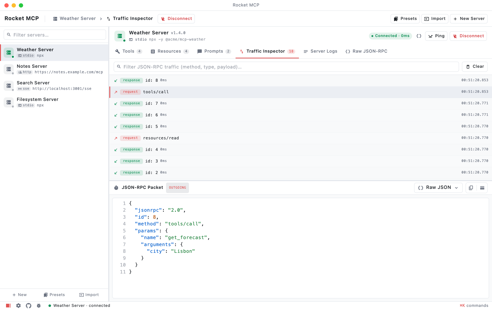

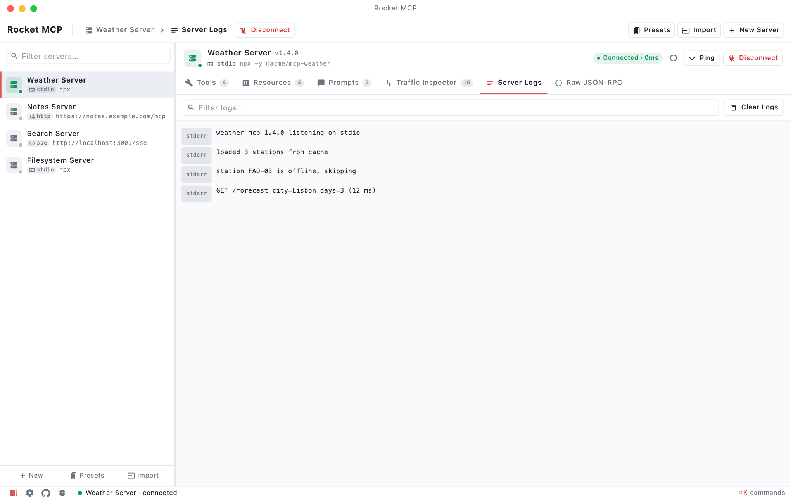

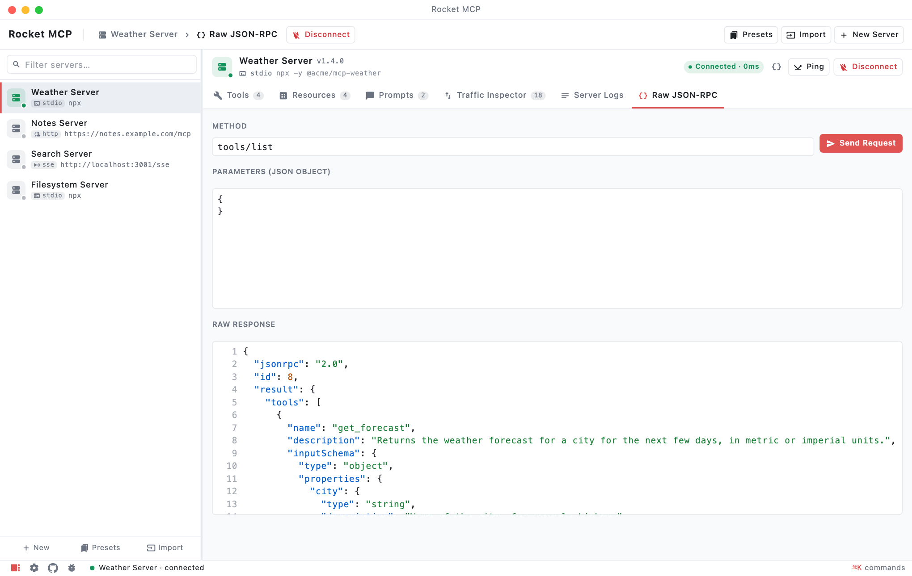

## Fast and keyboard friendly

A command palette (**⌘K / Ctrl+K**) reaches the main actions, and most of them have a shortcut. See [keyboard shortcuts](keyboard-shortcuts.md).

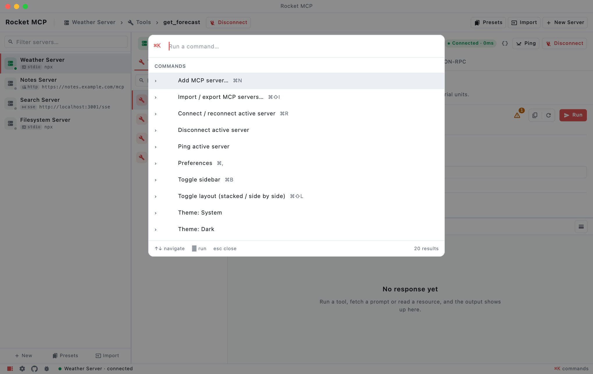

## Make it yours

System, light and dark themes; interface size from 77% to 154%; request and response panes stacked or side by side, with every divider remembered between launches; timeout, proxy and SSL settings. The window, the sidebar and the pane sizes are restored on relaunch.

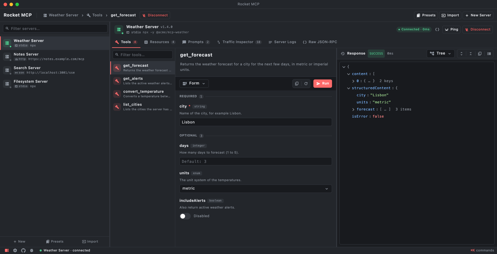

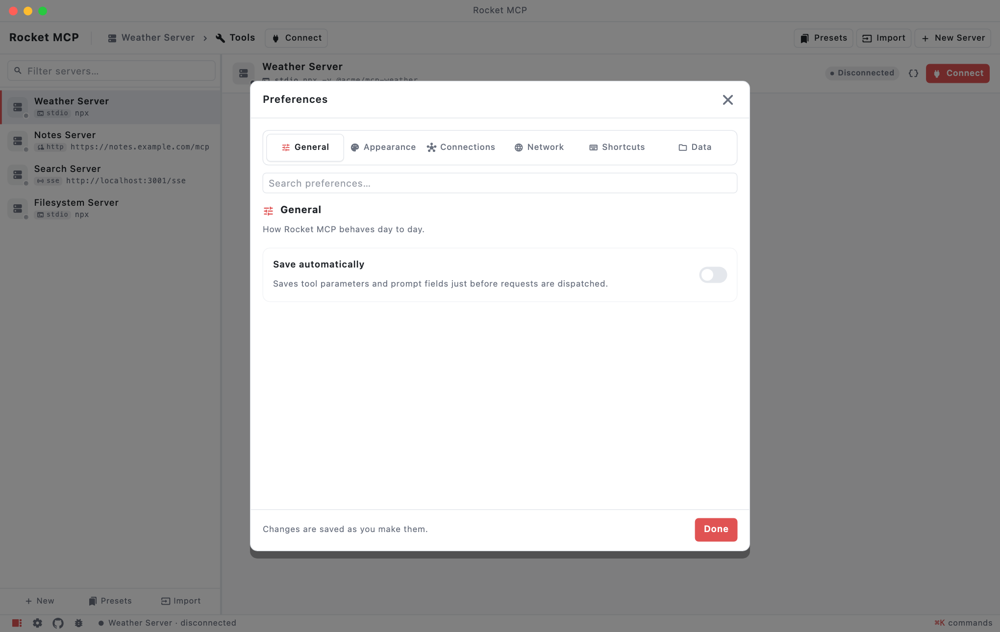

## Import and export

Bring servers in from a Claude Desktop configuration (`claude_desktop_config.json`) and export yours back out in the same format. See [import and export](import-export.md).

## Desktop polish

Native menus on macOS and an in-window menu bar on Windows and Linux, a custom title bar, a status bar that shows the active server's connection state, update notices from GitHub releases, and a one-click **Report an issue** button that pre-fills the app version and operating system.
