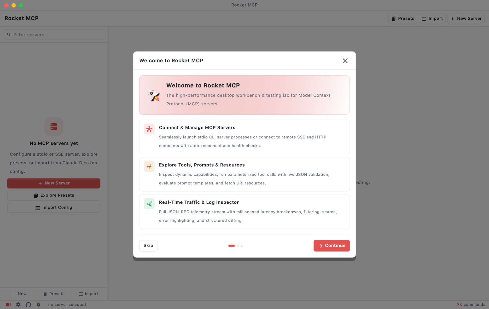
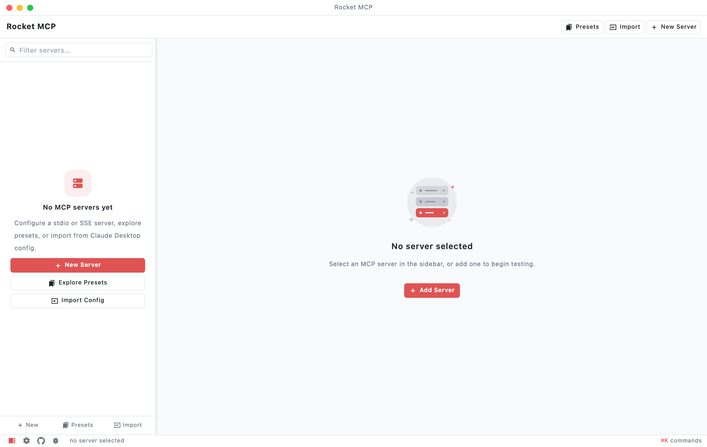
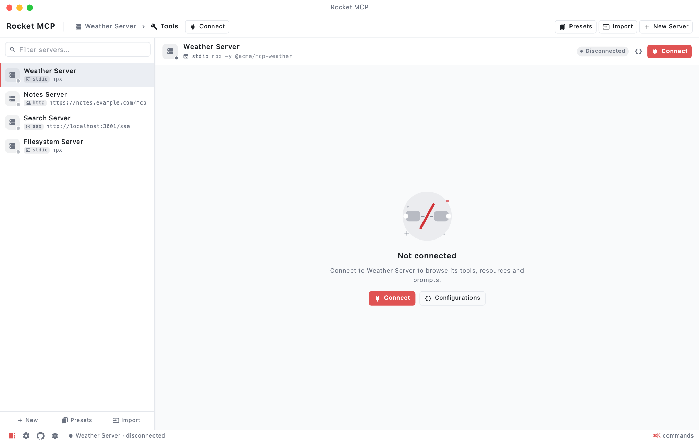
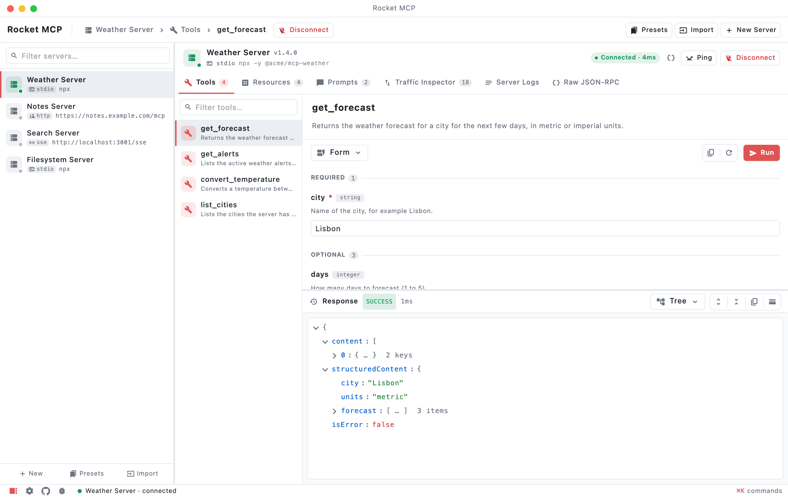

# Getting started

## Install

Rocket MCP is a Flutter desktop app for macOS, Windows and Linux. There are no installers yet, so run it from source:

```sh
git clone https://github.com/prateekthakur272/rocket_mcp.git
cd rocket_mcp
flutter pub get
flutter run -d macos      # or -d windows, -d linux
```

You need [Flutter](https://docs.flutter.dev/get-started/install) (stable) with the desktop toolchain for your system. To produce an application bundle instead, see [building and releasing](building-and-releasing.md).

Many MCP servers are started with `npx` or `uvx`, so Node.js and/or [uv](https://docs.astral.sh/uv/) need to be installed and on your `PATH` to use the sample servers.

## First run

A short tour appears the first time. It introduces connecting to servers, exploring tools, prompts and resources, and the traffic inspector. Reopen it any time from **Help ▸ Welcome Tour** or the command palette.



Until you add a server the sidebar is empty and offers three ways to start: **New Server**, **Explore Presets** and **Import Config**.



## Your first tool call

1. Press **⌘N / Ctrl+N** (or **New Server**). Pick a quick template such as *Everything Server*, or fill in the name, command and arguments yourself, then **Add Server**. See [servers and transports](servers-and-transports.md).
2. Select the server in the sidebar. The workspace says it is not connected; press **Connect**.

   

3. As soon as the connection is up, the server's **tools, resources and prompts are fetched at once**. The tabs show their counts.
4. On the **Tools** tab pick a tool, fill in its arguments (required ones first) and press **Run** or **⌘↵ / Ctrl+Enter**.
5. Read the result in the response panel: formatted text, raw JSON or an expandable tree.



Next: the [features tour](features.md) or the [user manual](user-manual.md).
