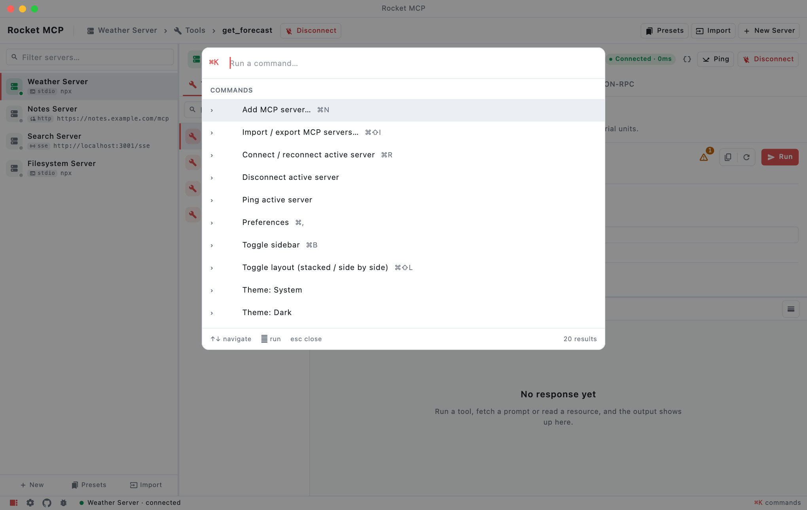

# Keyboard shortcuts

On macOS the shortcuts use **⌘**; on Windows and Linux use **Ctrl** in its place. They are also listed in **Preferences ▸ Shortcuts** (**⌘/ / F1**).

## Everywhere

| Action | Shortcut |
|---|---|
| Command palette | ⌘K or ⌘P |
| New server | ⌘N |
| Import / export servers | ⌘⇧I |
| Preferences | ⌘, |
| Keyboard shortcuts | ⌘/ or F1 |
| Show / hide the sidebar | ⌘B |
| Switch the layout (response below / beside) | ⌘⇧L |
| Zoom in / out / actual size | ⌘+ / ⌘− / ⌘0 |
| Open the data folder | ⌘⇧O |
| Close the open dialog or menu | Esc, or ⌘W for a dialog |

## The active server

| Action | Shortcut |
|---|---|
| Connect / reconnect | ⌘R |
| Disconnect | ⌘⇧D |
| Ping | ⌘⇧P |
| Refresh tools, resources and prompts | ⌘⇧R |

## Workspace tabs

| Action | Shortcut |
|---|---|
| Tools | ⌘1 |
| Resources | ⌘2 |
| Prompts | ⌘3 |
| Traffic Inspector | ⌘4 |
| Server Logs | ⌘5 |
| Raw JSON-RPC | ⌘6 |
| Next / previous tab | Ctrl+Tab / Ctrl+Shift+Tab |

## In a tool form

| Action | Shortcut |
|---|---|
| Run the tool | ⌘↵ (Ctrl+Enter), from any input |

## Command palette

Type to filter the list of commands, move with **↑ ↓**, run with **↵**, close with **Esc**. It covers adding servers, connecting, disconnecting, pinging, switching theme and layout, zoom, preferences, updates, the developer dialog, reporting an issue and showing the data folder. Commands that apply to the active server only appear while one is selected.
