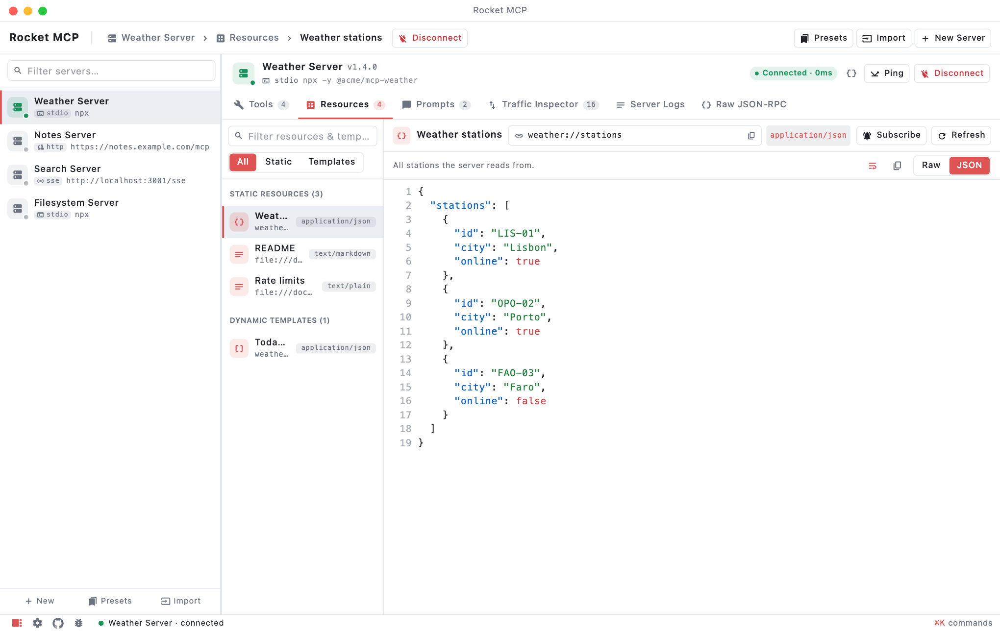
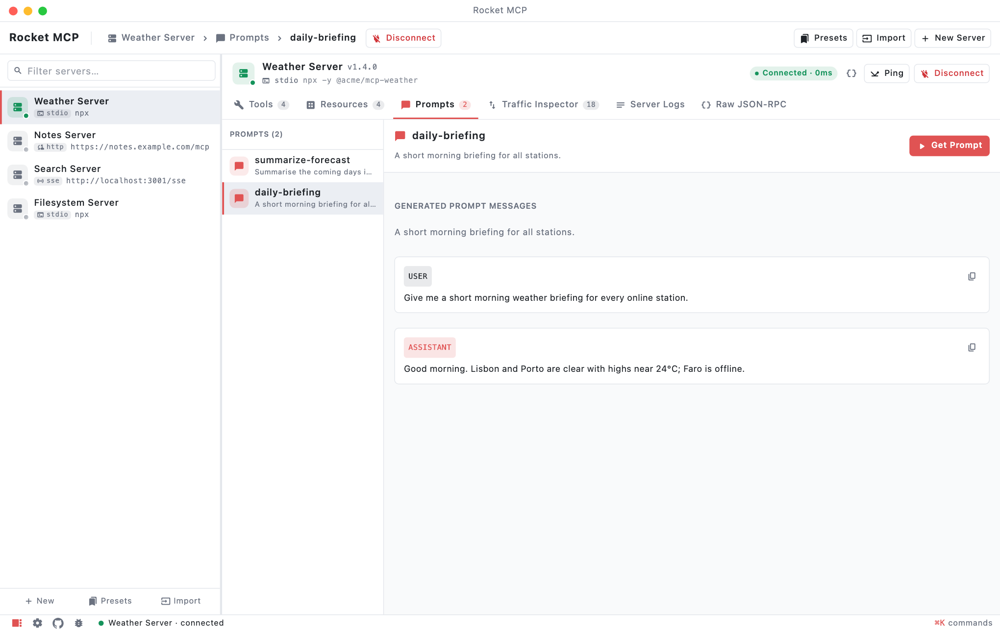

# Resources and prompts

## Resources

The **Resources** tab lists the data a server exposes: static resources and, under **TEMPLATES**, resource templates.

Each resource shows its name, its URI and a badge with its MIME type. The icon follows the type: JSON, HTML, XML, text, PDF, image, audio or video. The list's width can be dragged.

**Selecting a resource reads it immediately.** The contents appear on the right: text as text, binary blobs as a placeholder with their size. The first resource is selected and read for you when the server connects. The button next to the URI is **Read** at first and becomes **Refresh** once contents are showing; it reads the resource again.

### URI templates

A template such as `weather://{city}/today` has variables. Select it and one input appears for each variable; the **resolved URI** updates as you type, following the URI-template syntax (RFC 6570, including forms such as `{+path}` and `{?query,limit}`). The **Read** button stays disabled until every variable has a value (its tooltip says so); then it reads the resolved address.

### Subscriptions

If the server supports it, **Subscribe** asks to be told when a resource changes. A subscribed resource has a bell in the list. When the server sends an update for the selected resource, it is read again automatically. Pressing **Subscribed** turns the subscription off.

If a server has no templates, its plain resources are still listed.

## Prompts

The **Prompts** tab lists the prompt templates a server offers.

Selecting a prompt shows its description and one input for each argument; required ones are marked. A prompt that has **no required arguments is fetched as soon as you select it**, and so is the first prompt when you connect. A prompt with required arguments waits until you press **Get Prompt**.

The result is shown as the prompt's messages, each with its role (`user`, `assistant`) and text.

## When a list is empty

| What you see | Why |
|---|---|
| **Loading …** | The first fetch after connecting is still running |
| **No tools / resources / prompts** | The server does not offer any |
| **No matching …** | Your filter hides every item |

The lists are loaded when you connect and refresh themselves when the server announces a change. There is no refresh button. To fetch everything again, press **⌘⇧R / Ctrl+Shift+R** (also in the menus), or reconnect with **⌘R / Ctrl+R**.
