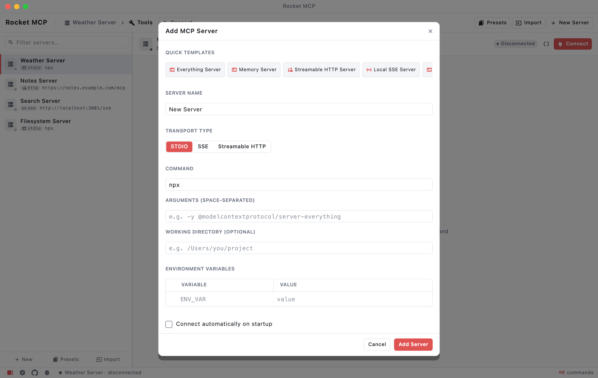

# Servers and transports

A **server** in Rocket MCP is a saved description of how to reach one MCP server. Servers are listed in the sidebar; select one to work with it.

## Adding a server

Press **⌘N / Ctrl+N**, **New Server** in the header, or **New** at the bottom of the sidebar.

The dialog has these fields:

| Field | Meaning |
|---|---|
| **Quick templates** | One click fills in a well-known server (see [presets](#presets)) |
| **Server name** | The name shown in the sidebar, header and breadcrumb |
| **Transport type** | `STDIO (Local Process)`, `SSE (Server-Sent Events)` or `Streamable HTTP` |
| **Command**, **Arguments** | stdio only. The executable and its arguments, separated by spaces |
| **Working directory** | stdio only, optional. Where the process starts |
| **Environment variables** | stdio only. Extra variables passed to the process |
| **URL** | SSE and streamable HTTP. The endpoint |
| **HTTP headers** | SSE and streamable HTTP. For example `Authorization` |
| **Connect automatically on startup** | Connect as soon as the app opens |

To change a server later, open its **Configurations** (the `{}` button in the server header, or **Configurations** in the row's menu).

## The three transports

| Transport | What happens | Typical use |
|---|---|---|
| **stdio** | Rocket MCP starts the command as a child process and talks to it over its standard input and output. Whatever the process writes to standard error appears in **Server Logs** | Local servers started with `npx`, `uvx`, `node`, `python` |
| **SSE** | Opens a server-sent-events stream at the URL and posts requests to the endpoint the server announces | Older remote servers |
| **Streamable HTTP** | Sends each message as an HTTP request to the URL and reads the reply, which may stream | Current remote servers |

The row in the sidebar shows the transport with its own icon (a terminal, a broadcast signal or a synced cloud) and a short tag (`stdio`, `sse`, `http`).

## Connecting

Select a server and press **Connect** in the header (or **⌘R / Ctrl+R**). While connecting the workspace shows a spinner. When the server has answered the `initialize` request:

- the header shows its name and version, and the status chip turns **Connected**, with the ping time;
- its tools, resources, resource templates and prompts are fetched together;
- the tabs show their counts.

If the connection fails the workspace says **Could not connect** and shows the error, with **Try again** and **Configurations** buttons. **Disconnect** (header, row menu or **⌘⇧D**) closes the connection and stops a stdio process.

The tabs and panes only exist while a server is connected, so there is nothing to look at before then. The status bar always shows the active server and its state.

## Presets

**Presets** (header and sidebar) opens the same templates as the dialog. They are starting points: edit them before relying on them.

| Preset | Transport | Starts |
|---|---|---|
| Everything Server (Reference/Testing) | stdio | `npx -y @modelcontextprotocol/server-everything` |
| Memory Server (Knowledge Graph) | stdio | `npx -y @modelcontextprotocol/server-memory` |
| Streamable HTTP Server (Sample) | streamable HTTP | `http://localhost:8000/mcp` |
| Local SSE Server (Sample) | SSE | `http://localhost:3001/sse` |
| Filesystem Server | stdio | `npx -y @modelcontextprotocol/server-filesystem .` |
| Fetch Server (Web) | stdio | `npx -y @modelcontextprotocol/server-fetch` |
| SQLite Server | stdio | `uvx mcp-server-sqlite --db-path test.db` |

The first time the app starts with no saved servers, the first four are added for you.

## Managing servers

Hover a row for **Connect / Disconnect** and **⋯**, or right-click it:

| Action | Does |
|---|---|
| Connect / Disconnect | Opens or closes the connection |
| Configurations | Opens the server's settings |
| Duplicate | Copies the server |
| Delete | Removes it (and closes its connection) |

The filter box above the list searches names, commands and URLs.

A connected row also shows what the server offers: the number of tools, resources and prompts, and the ping time.

## Where servers are saved

In `servers.json` in the [data folder](data-and-storage.md). It is plain JSON, so you can edit it or keep it in version control.
