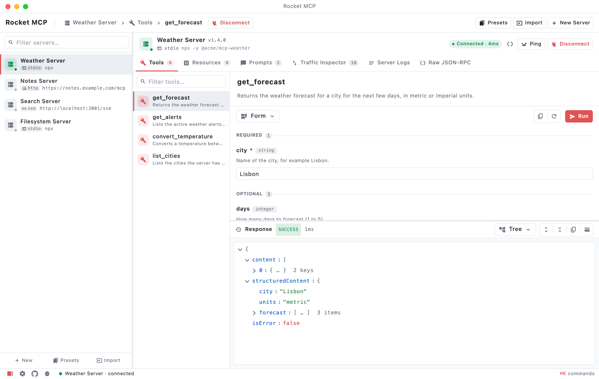
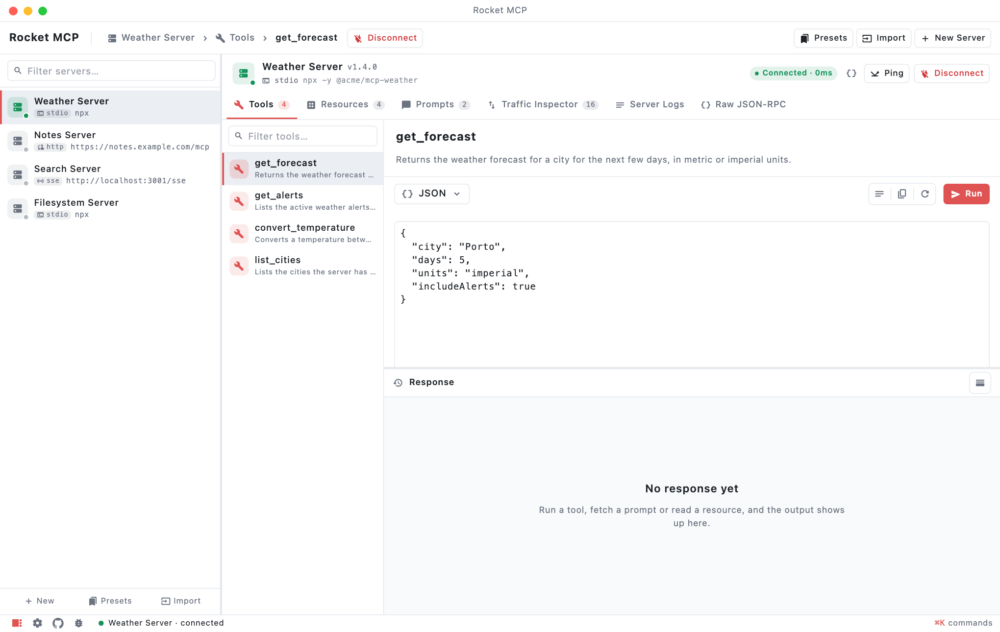
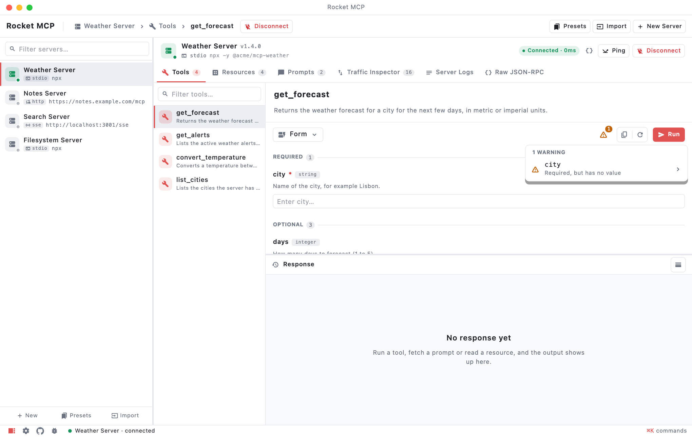

# Testing tools

The **Tools** tab lists the tools the server offers. Choose one to see its description and an input form built from its input schema.

## The tool list

The list on the left shows each tool's name and the start of its description. Use the filter box to search names and descriptions. Drag the list's right edge to resize it; the width is remembered. The count on the tab is the number of tools.

## The form

Each argument in the tool's JSON schema becomes a field, with its name, a red `*` when it is required, a type badge and its description.

| Schema | Field |
|---|---|
| `string` | Text field |
| `number`, `integer` | Text field that stores a number |
| `boolean` | Switch, labelled Enabled / Disabled |
| `enum` | Drop-down of the allowed values |
| `array`, `object` | A JSON editor |
| a `default` value | Shown as the placeholder (`Default: 3`) |

Required arguments are listed first under **REQUIRED**, then **OPTIONAL**. Arguments you never touch are not sent.

## The toolbar

| Control | Does |
|---|---|
| **Form / JSON** menu | Switches between the form and a raw JSON body. Values you typed carry across when you switch back |
| Warnings button | Appears when something blocks a run; see below |
| Format (JSON mode) | Re-indents valid JSON |
| Copy | Copies the arguments as JSON |
| Clear | Empties all arguments |
| **Run** (⌘↵ / Ctrl+Enter) | Calls the tool |

While a call is running the button reads **Running…**.

## JSON mode

Choose **JSON** to type the arguments as a JSON object yourself.

The body is checked as you type. Under the editor you see **Valid JSON** in green, or the problem in red, with the line and column of a syntax error. The text must be a JSON **object**: an array, a string or empty text is rejected. While the JSON is invalid the editor has a red outline and **Run** does not send anything.

## Warnings

When a required argument has no value, or the JSON is invalid, a warning button with a count badge appears in the toolbar. Click it for a list of what is wrong.

Click an argument in the list to jump to it: the form scrolls to the field, puts the cursor in it where it is a text input, and flashes it red. Pressing **Run** with a value missing does the same for every missing field and shows what to fill in.

## The result

The response panel shows the outcome: a **SUCCESS** or **ERROR** badge and how long the call took. The view menu picks the format:

| View | Shows |
|---|---|
| **Formatted** | The tool's text content |
| **Raw JSON** | The whole result with syntax colouring and line numbers, with a wrap toggle |
| **Tree** | An expandable tree, with expand-all and collapse-all |
| **Images** | Image content, when the result has any |

Copy puts the current view on the clipboard. The layout button switches the response between below and beside the request (⌘⇧L); the divider is draggable and its position is remembered.

The Tools tab is the only one with a response panel. Resources, prompts, the raw JSON-RPC tab and the logs show their results inside their own views; the Traffic Inspector has its own packet pane.
