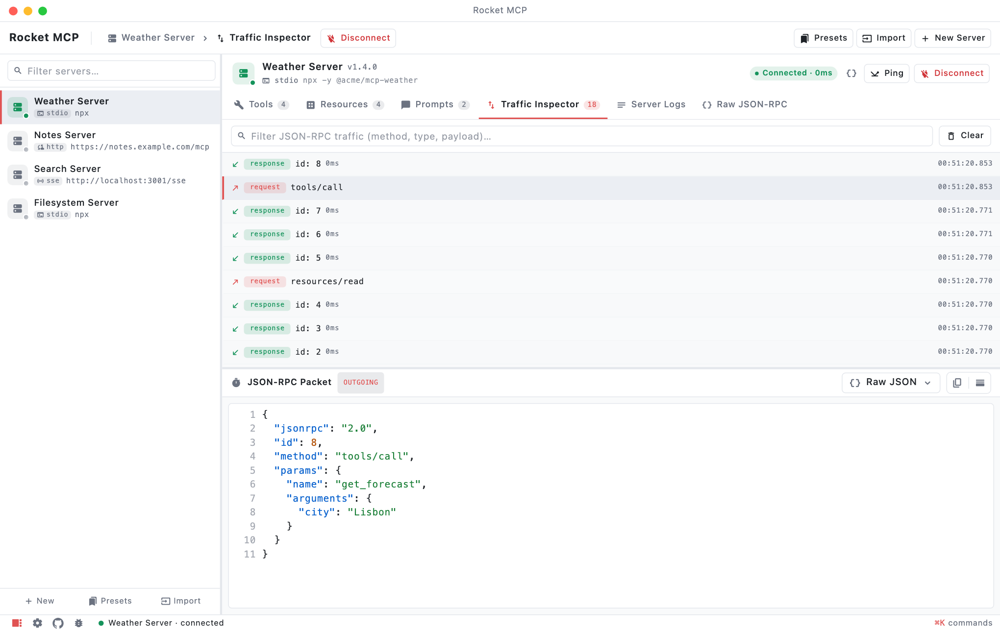
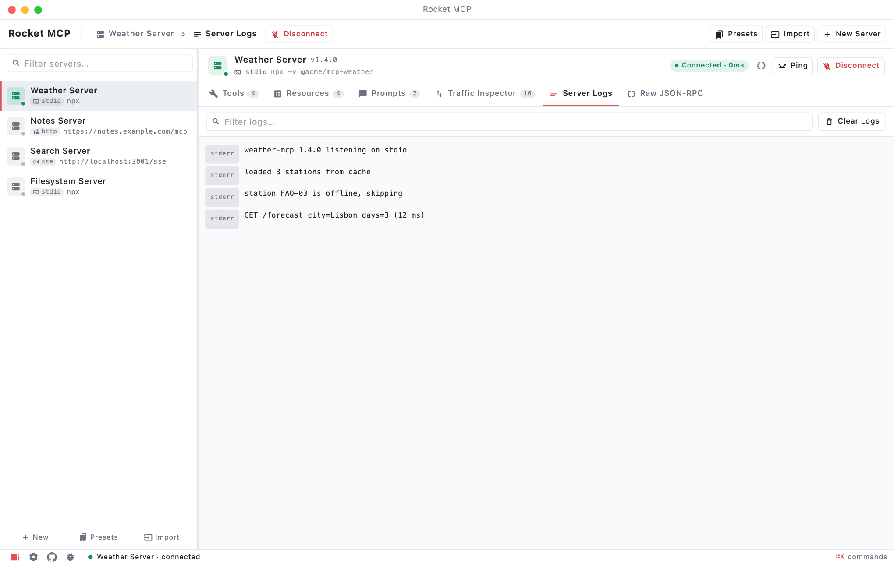
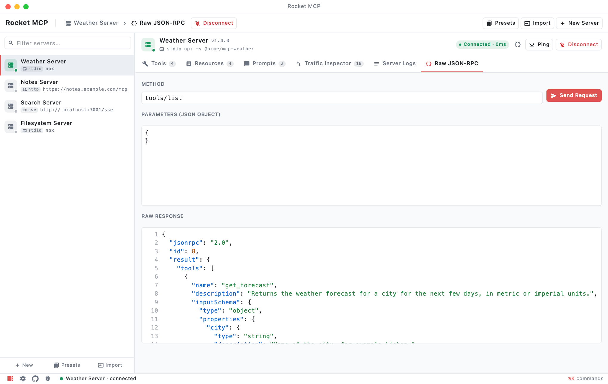

# Traffic and logs

Three tabs show what is happening on the wire: the **Traffic Inspector**, **Server Logs** and **Raw JSON-RPC**.

## Traffic Inspector

Every JSON-RPC message between Rocket MCP and the server is recorded: requests, responses (with errors) and notifications, in both directions. The tab shows how many there are.

Each row shows:

- an arrow for the direction (sent or received),
- a type badge (`request`, `response`, `notification`, error responses in red),
- the method for requests and notifications, or the `id` and the **time the server took to answer** for responses,
- the time the message was sent or received.

Newest messages are at the top. Type in the filter box to narrow the list by method, type or any text in the payload. **Clear** empties the history.

Click a row to inspect it. The **JSON-RPC Packet** pane below (or beside, with the layout switch) shows the message as **Raw JSON** with line numbers, or as an expandable **Tree**, with copy and expand/collapse buttons. Drag the divider to resize the panes; the size is remembered.

Use it to check exactly what a tool call sent, what the server answered, how long it took, and which notifications arrive when a list changes.

## Server Logs

For a **stdio** server this shows the lines the process writes to standard error, which is where most servers print diagnostics, plus any log messages the server sends over MCP. Use the filter box to search and **Clear Logs** to empty the list.

This is the first place to look when a server will not start or a tool fails without a useful error.

## Raw JSON-RPC

Send any JSON-RPC request yourself. Type a **method** such as `tools/list`, `ping`, `resources/read` or a custom one, write the **params** as JSON, and press **Send Request**. The server's answer appears below. Everything you send also shows up in the Traffic Inspector.

Use it to try methods that have no screen yet, or to send a deliberately malformed request and see how a server reacts.

## When there is nothing to show

Each tab explains itself when empty: *No traffic yet*, *No server logs yet*. The tabs, like the rest of the workspace, only exist while a server is connected.
