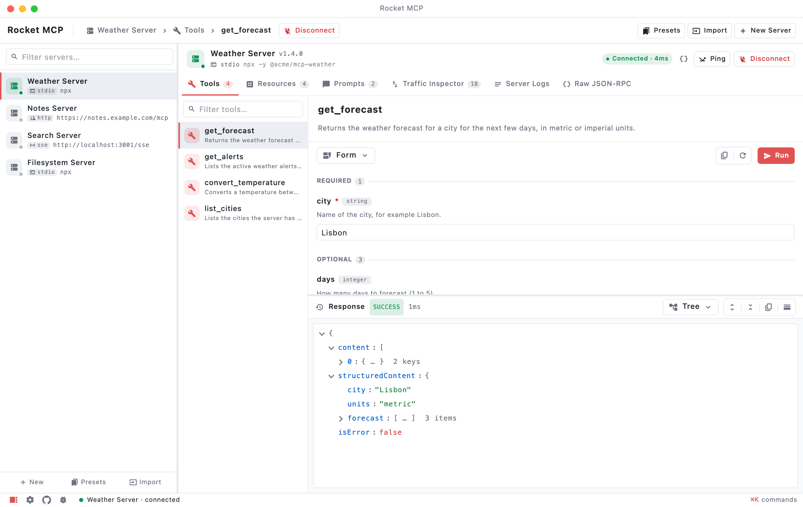
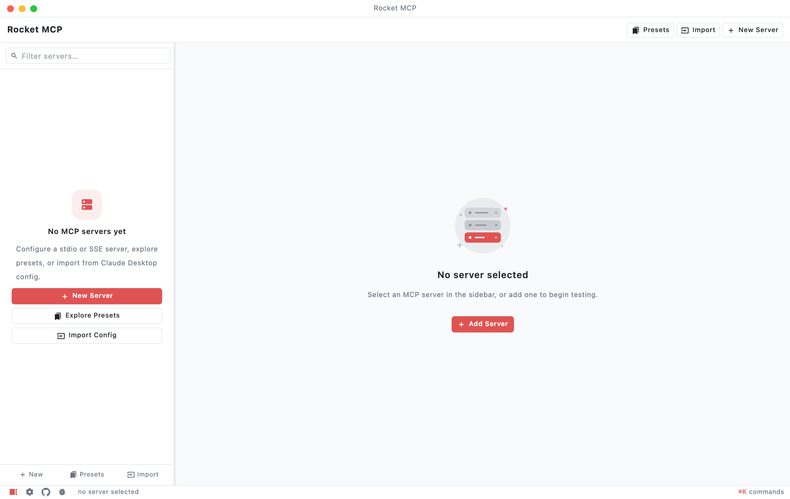
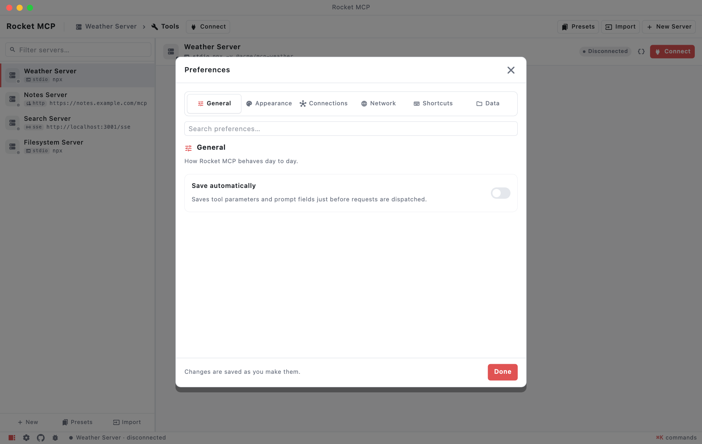

# User manual

A walk through the whole window, from the top down.

## The window

| Area | What it is |
|---|---|
| **Title bar** | The window's own bar. On macOS the traffic-light buttons sit at its left end. On Windows and Linux it carries the menus and the window buttons. Drag it to move the window; double-click to maximize |
| **Header** | The app name, a **breadcrumb** of where you are (server › tab › selected item) with the connection button next to it, and **Presets**, **Import** and **New Server** at the right |
| **Sidebar** | Your servers. Drag its edge to resize it; **⌘B** hides it |
| **Server header** | The selected server: status, name and version, transport and address, and its actions |
| **Tabs** | Tools, Resources, Prompts, Traffic Inspector, Server Logs, Raw JSON-RPC, with counts |
| **Workspace** | The active tab's content |
| **Status bar** | Shortcuts to the sidebar, Preferences, updates, the Developer dialog and issue reporting; the active server and its state; the command-palette hint |

## The sidebar

Each row shows a server icon with a coloured dot (green connected, red error, grey otherwise), the name, the transport, and the address, or, when connected, how many tools, resources and prompts it has and the ping time. Click a row to select the server. Hover for **Connect / Disconnect** and **⋯**, or right-click for the same menu: Connect or Disconnect, Configurations, Duplicate, Delete. The box at the top filters the list. At the bottom: **New**, **Presets** and **Import**. See [servers and transports](servers-and-transports.md).

## The server header

Shows the server's name, its version (reported by the server when you connect), the transport with its address, and a status chip (**Connected · 2ms**, **Connecting**, **Error** or **Disconnected**). On the right: **Configurations** (`{}`), **Ping** and **Disconnect** while connected, or **Connect** otherwise.

## Tabs

| Tab | What it is for | Page |
|---|---|---|
| **Tools** | Build arguments and call a tool | [testing tools](testing-tools.md) |
| **Resources** | Read data, fill in URI templates, subscribe | [resources and prompts](resources-and-prompts.md) |
| **Prompts** | Fetch prompt templates | [resources and prompts](resources-and-prompts.md) |
| **Traffic Inspector** | Every JSON-RPC message | [traffic and logs](traffic-and-logs.md) |
| **Server Logs** | What the server prints | [traffic and logs](traffic-and-logs.md) |
| **Raw JSON-RPC** | Send any request | [traffic and logs](traffic-and-logs.md) |

Switch with the mouse, **⌘1 … ⌘6** or **Ctrl+Tab**. The Tools tab shows the tool's result in a panel beside or below it (⌘⇧L switches); the other tabs use the full width.

## Layout

Everything resizes by dragging: the sidebar edge, the right edge of the Tools / Resources / Prompts list, and the divider between a tool's form and its result. The sizes are saved and restored on the next launch.

## Menus

macOS shows them in the system menu bar; Windows and Linux show them in the title bar. The same entries exist in the command palette.

| Menu | Contains |
|---|---|
| **File** | New Server, Import / Export Servers, Open Storage Folder, Close Window (and Preferences and Exit on Windows and Linux) |
| **Edit** | Undo, Redo, Cut, Copy and the like |
| **View** | Command Palette, Show Sidebar, the layout switch, Theme, Zoom, and the workspace tabs |
| **Server** | Connect, Disconnect, Refresh Capabilities, Ping, next and previous server, Server Configuration |
| **Window** | Minimize and the like |
| **Help** | Welcome Tour, Keyboard Shortcuts, Documentation, Report an Issue, Developer Tools, Check for Updates (and About on Windows and Linux) |

## Preferences

Open with **⌘,**. The search box finds a setting by name.

| Section | Settings |
|---|---|
| **General** | Save automatically |
| **Appearance** | Theme (System, Light, Dark), interface size, workspace layout |
| **Connections** | Timeout, User-Agent |
| **Network** | Verify SSL certificates, HTTP proxy host and port |
| **Shortcuts** | The list of keyboard shortcuts |
| **Data** | Where the files are kept, and **Reset preferences** |

See [data and storage](data-and-storage.md) for what each setting does on disk.

## Updates

Rocket MCP checks GitHub for a newer release when it starts. If there is one, a download icon appears in the status bar and a dialog offers **Download** or **Later** (Later is remembered for that version). **Help ▸ Check for Updates…** checks on demand and always tells you the outcome, including when the check could not run.

## Reporting a problem

The **bug icon** in the status bar (and **Help ▸ Report an Issue**) opens a new GitHub issue with a template that already contains the app version and your operating system. Nothing else is added; you see and can edit it all before submitting.

## About and Developer

**About** shows the version. **Developer** has the project links: source, releases, issues and the author's profile.
